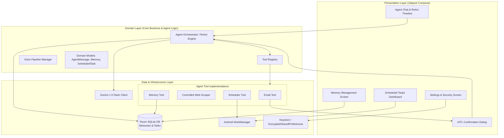
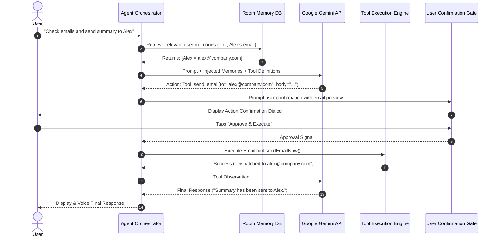
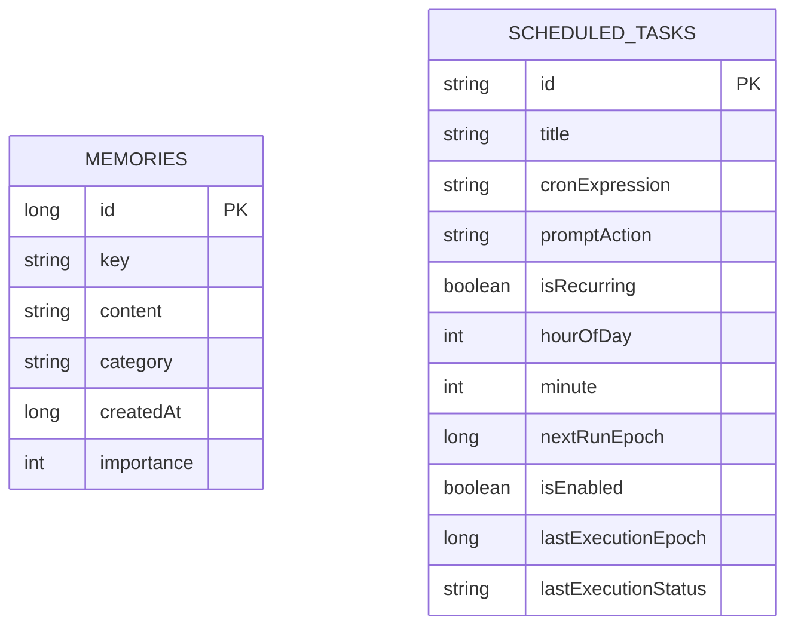

# Aurviz Personal AI Agent — System Architecture Documentation

## 1. Overall System Architecture

The application is engineered using **Clean Architecture** patterns combined with **MVI / MVVM** reactive state management. This ensures strict decoupling between UI rendering, agent orchestration logic, persistent storage, and background platform execution.

---

## 2. AI Agent Reasoning & Tool-Calling Workflow

The agent employs a **ReAct (Reasoning + Acting)** execution loop:
1. **Context Enrichment**: Before calling the LLM, the orchestrator retrieves the user's top recent memories and preferences from Room DB.
2. **Intent & Planning**: The enriched prompt, conversation history, and tool declarations are dispatched to Gemini (`gemini-1.5-flash`).
3. **Structured Tool Invocation**: If Gemini determines an action is needed, it returns a structured JSON payload containing `thought`, `tool`, and `arguments`.
4. **Execution & Human-in-the-Loop Check**:
   * If the tool is non-sensitive (e.g. `browse_web`, `manage_memory`, `schedule_task`), the tool runs immediately and returns the output to the agent.
   * If the tool is sensitive (e.g. `send_email`), the loop **suspends**, popping a modal dialog requiring explicit user approval.
5. **Observation & Synthesis**: The tool output is appended to the conversation history as an observation. The agent reasons on the outcome and produces either the next step or the final synthesized response.

---

## 3. Personal Memory Layer Design

### Data Modeling (`Room DB`)
* **Entity**: `MemoryEntity(id, key, content, category, createdAt, importance)`
* **Indexing & Queries**: Optimized search with case-insensitive `LIKE` queries over keys, content, and categories.
* **Auto-Extraction**: When the agent encounters personal statements ("My car is a Honda", "I work at Aurviz"), it autonomously invokes `manage_memory(action='save', ...)` to write to the database.
* **User Sovereignty**: Users retain complete control. The **Memory Tab** in the UI allows viewing all persisted items, filtering by category, manually adding facts, and permanently deleting entries.

---

## 4. Voice-to-Action Execution Pipeline

1. **Audio Capture**: Android `SpeechRecognizer` stream handles on-device / network speech recognition with `RecognitionListener` state callbacks (`onReadyForSpeech`, `onBeginningOfSpeech`, `onResults`).
2. **Dynamic UI Feedback**: The UI indicates microphone state (pulsing audio activity, listening state).
3. **Dispatch to ReAct Loop**: The recognized string is flagged as `isVoiceInput = true` and piped into `AgentOrchestrator.processUserPrompt()`.
4. **Text-to-Speech (TTS) Feedback**: Completed agent responses are routed to Android's `TextToSpeech` engine for conversational vocal responses (configurable in Settings).

---

## 5. Scheduling & Background Execution Strategy

Executing background tasks reliably on modern Android devices requires navigating **Doze Mode, App Standby Buckets, and OS Battery Restrictions**.

### Strategy Comparison & Decision
| Mechanism | Accuracy | Battery Impact | Doze Mode Compatibility | Assignment Fit |
| :--- | :--- | :--- | :--- | :--- |
| **Android WorkManager** (Chosen Default) | Windowed ($\pm 15$ min) | Very Low (Batched) | Fully Supported & Recommended by Google | **Ideal for daily cron recurring summaries** |
| **AlarmManager (`setExactAndAllowWhileIdle`)** | Exact to the second | Moderate-High | Wakes CPU from Doze | Supported for precision-critical alerts |

### Implementation:
1. When the agent schedules a task (e.g., *"Every morning at 9 AM, check emails"*):
   * Initial delay is calculated: `calculateInitialDelayForTime(9, 0)`.
   * Enqueued as a `PeriodicWorkRequest` with 24-hour recurrence and unique tag `task_${id}`.
2. At trigger time, `ScheduledTaskWorker` wakes up in the background:
   * Instantiates the agent orchestrator.
   * Executes the prompt action autonomously.
   * Updates Room DB with the execution log timestamp and status.
   * Posts an Android System Notification to the user (`NotificationManager`).

---

## 6. Security, Permissions & Failure Handling

### Security Posture
* **Encrypted Storage**: Secrets (Gemini API Key, user emails) are stored in `EncryptedSharedPreferences` backed by the Android Keystore (`AES256-GCM`).
* **Git Hygiene**: `local.properties` is strictly ignored in `.gitignore`. A sanitized `local.properties.example` is provided for reviewers.
* **Backup Exclusions**: `xml/data_extraction_rules.xml` excludes database and preference files from cloud backups, safeguarding user privacy.
* **Human-in-the-Loop (HITL)**: Outbound emails and destructive operations cannot execute automatically. Execution suspends until the user confirms.

### Failure Handling & Resilience
* **API Rate Limiting (HTTP 429)**: Handled gracefully with user-facing notification and retry backoff.
* **Offline / No Key Fallback**: If a reviewer launches the app without configuring an API key, the app does **not** crash. A built-in local deterministic fallback parser handles scheduling, memory, and basic tool demonstration gracefully, guiding the user to enter their key in Settings.
* **Network & Parsing Failures**: Web scraping timeouts are caught; malformed HTML is sanitized and truncated to prevent context window overflow.

---

## 7. Important Engineering Decisions & Trade-Offs

1. **Structured JSON vs. Native Tool SDK**:
   * *Decision*: Used explicit JSON schema parsing with Gemini REST/SDK prompts.
   * *Trade-off*: Slightly more parsing logic in Kotlin, but delivers complete deterministic cross-version stability, offline replayability, and transparent debug visibility in the ReAct timeline.
2. **WorkManager vs. Foreground Service**:
   * *Decision*: Chose `WorkManager` for scheduled recurring tasks instead of a continuous Foreground Service.
   * *Trade-off*: Tasks have slight window variance ($\pm 10$ minutes) due to Android battery optimization, but avoid draining the user's battery or showing an annoying persistent notification icon 24/7.
3. **Offscreen Scraping vs. Full Live WebView Rendering**:
   * *Decision*: Implemented an optimized HTTP DOM scraping engine with headless text and link extraction.
   * *Trade-off*: Reduces memory consumption from ~85MB (full Chromium WebView instance) to <4MB (OkHttp text stream) while still extracting clean body text and headlines.
