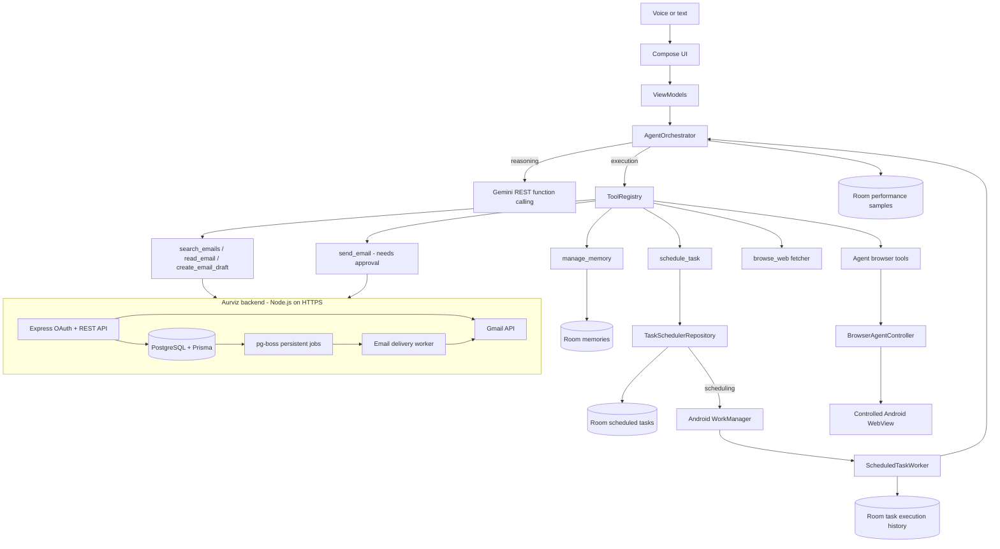

# Architecture

## System view

The Android app is one Gradle module with packages for presentation, domain (orchestrator, models, repository interfaces, tool contract, metrics), data (Room, remote clients, tools) and platform services (voice, background, web). The backend is a separately deployable Node.js service that owns Google credentials.

## Three separate concerns

| Concern | Who does it | Where |
|---|---|---|
| Reasoning: decide what to do next | Gemini, via function calling | `GeminiAgentClient`, prompt in `AgentOrchestrator` |
| Execution: actually perform the operation | Kotlin `AgentTool` implementations and the backend | `data/tools/*`, `backend/src/routes/*` |
| Scheduling: wake up later and run | Android WorkManager (persisted in its own DB) | `TaskSchedulerRepositoryImpl`, `ScheduledTaskWorker` |

Gemini cannot wake the app. A scheduled task is persisted in Room and registered with WorkManager. When WorkManager runs the worker, the worker calls `executeAutonomousTask`, which runs the same reason→act loop with background safety rules. WorkManager periodic work is durable across restarts and reboots but is not exact to the minute: Doze and battery policy can defer it.

## Interactive agent flow

1. Speech recognition or typed input produces a prompt. Both go through `AgentOrchestrator.processUserPrompt`.
2. Relevant memories (lexical match plus a few recent ones) are injected into the system instruction, so preferences such as "I prefer formal emails" shape later drafts.
3. The system instruction tells the model how to plan. It breaks the request into steps and calls one tool at a time. It uses `create_email_draft` (never `send_email`) when told to draft or "don't send". It asks for clarification when a recipient is only a name with no saved address. It never invents inbox content.
4. Loop: model turn → tool call → observation → next model turn, bounded to 8 steps. Every tool call appears in chat as a timeline row (Running → Success/Failed/Awaiting approval). Hitting the step limit produces a visible error with Retry; a request never ends silently.
5. Sensitive tools (`send_email`, browser click/type) pause the loop and show an editable confirmation dialog. Only approval runs `executeConfirmed`.
6. Gemini errors appear as real error messages. Transient ones (network, timeout, 429, 5xx) get a **Retry** button. A small local reply covers greetings and help when Gemini is overloaded, but it never executes tools or hides other failures.
7. Conversation and tool states persist in a bounded (100 message) JSON store.

Example: "Check my emails, find interview invitations, and summarize them" becomes `search_emails(query="subject:interview newer_than:14d")`, then `read_email(id)` for the relevant hits, then the final summary.

## Gmail

Google credentials live only on the backend. Android starts OAuth by opening `/auth/google` in the browser. The backend validates state, exchanges the code, and encrypts the refresh token with AES-256-GCM. It then redirects to `aurviz://oauth/callback` with a 5-minute one-time code, which Android exchanges for an opaque session token stored in Keystore-backed encrypted preferences. The user never gives Aurviz a password.

Scopes: `gmail.send` (approved sends), `gmail.readonly` (search/read for summaries), `gmail.compose` (drafts).

| Tool | Backend route | Side effect |
|---|---|---|
| `search_emails` | `GET /api/v1/gmail/messages` | none (read) |
| `read_email` | `GET /api/v1/gmail/messages/:id` | none (read) |
| `create_email_draft` | `POST /api/v1/gmail/drafts` | draft saved, not sent |
| `send_email` | `POST /api/v1/emails/send` (idempotency key) | sends; requires in-app approval |

Because the backend holds the refresh token, scheduled email summaries work while the app is closed. Background runs can search, read and draft, but `send_email` is always blocked in background mode.

Backend delivery: pg-boss jobs carry email id and version, and editing bumps the version so stale jobs cannot send. Gmail 429 is retried with backoff. Definite 4xx becomes `FAILED`; ambiguous 5xx/network results become `UNKNOWN` and are never auto-resent. Gmail plus a separate database cannot be exactly-once.

## Scheduled tasks and reliability

- Definitions in Room (`scheduled_tasks`); WorkManager unique work per task (`task_<id>`, `task_<id>_manual`) prevents duplicate enqueues. An in-process guard drops a second concurrent run of the same task.
- Pause cancels the WorkManager job but keeps the definition. Resume re-registers it and recomputes the next run. A run that finishes after a pause never silently resumes the task.
- Each attempt is written to `task_executions` (status, message, start, duration, attempt number) and shown in Tasks → History.
- Before running, the worker checks connectivity. When the device is offline, a tool reports a transient failure (`retryable = true`), or Gemini returns a retryable error, the run is recorded as **Retrying** and WorkManager retries with exponential backoff (up to 3 times). Runs are never marked successful when a required tool failed.
- Email tasks are skipped with a clear status when Gmail is not connected.
- Results and failures post a notification.

## Memory

Room `memories` with save, recall, update and delete from both the Memory screen (add/edit/delete with confirmation) and the agent (`manage_memory`). Saving an existing key updates it instead of duplicating. Update/delete act only on one unambiguous match; otherwise the agent gets the candidates and asks. Retrieval is lexical, not vector-based.

Database migrations are explicit (`MIGRATION_1_2`). Upgrading never wipes memories or tasks; only installing an older build (downgrade) resets local data.

## Performance measurement

`PerformanceRecorder` records on-device durations for each agent turn, Gemini call, memory retrieval, tool call and scheduled run into Room (bounded to the newest 1000 samples). Settings → Performance shows n / median / p95 / success rate. See [PERFORMANCE.md](PERFORMANCE.md).

## Browser control

`BrowserAgentController` provides one active session and a command/result channel between tools and the visible WebView. The tools are `open_url`, `search_webpage`, `read_page`, `click_element`, `enter_text`, `scroll_page`, `navigate_back`, `navigate_forward` and `get_browser_state`. Navigation is HTTPS-only and rejects private/local destinations. The WebView has no JavaScript-to-native bridge, file/content access is disabled, and Safe Browsing is on. Click and text entry require approval; text entry never submits. This is a controlled WebView, not a hardened sandbox, so avoid authenticated or financial flows.

## Extending (maintainability and scalability)

Adding a capability such as Google Calendar takes four steps, with no orchestrator changes:
1. Implement `AgentTool` (and backend route if it needs Google credentials).
2. Add its function declaration in `GeminiAgentClient.functionDeclarations()`.
3. Register it in `AurvizApp`'s `ToolRegistry`.
4. Set `isSensitive = true` if it has external side effects, so it automatically gets the approval gate and is blocked in background runs.

## Security summary

- Gemini key and backend session token are in Keystore-backed `EncryptedSharedPreferences`, excluded from backup. No plaintext fallback.
- No OAuth client secret or refresh token exists in the app or repository. Backend secrets come from environment configuration.
- Backend: OAuth CSRF state, one-time codes, hashed session tokens, AES-GCM refresh tokens, Helmet, rate limiting, zod validation, header-injection rejection, 32 KB body limit, redacted logs.
- A Gemini key typed into the app is still extractable on a rooted device; a production build should proxy Gemini through the backend with quotas.
