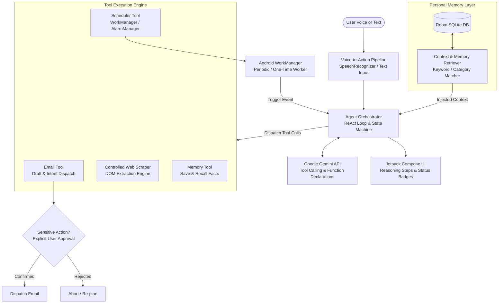

# Aurviz Personal AI Agent — Android Application

[](https://kotlinlang.org)
[](https://developer.android.com/jetpack/compose)
[](https://developer.android.com/topic/architecture)
[](LICENSE)

An autonomous, native Android personal AI agent that understands natural-language voice and text commands, maintains a persistent personal memory layer, and executes real-world multi-step tasks across email dispatch, controlled web navigation, and background scheduling.

---

## 🌟 Core Highlights & Capabilities

* **Voice-to-Action Execution**: Seamless voice recognition via Android `SpeechRecognizer` and Text-to-Speech (TTS) auditory feedback.
* **Autonomous ReAct Agent Engine**: Implements the **Reason + Act** loop using the **Google Gemini API** (`gemini-1.5-flash`), decomposing complex natural language goals into sequential tool calls.
* **Human-in-the-Loop (HITL) Safety Checkpoint**: Critical actions (such as sending emails) pause execution and present an explicit confirmation card with interactive preview before dispatch.
* **Personal Memory Layer**: Persists user preferences and interaction facts across app restarts using **Android Room DB**, with semantic context injection and a full CRUD UI (view, filter, delete).
* **Controlled Web Automation**: An in-app headless web automation engine capable of scraping, parsing DOM structures, and extracting clean article bodies and headlines.
* **Reliable Background Task Scheduling**: Handles cron-like recurring jobs (e.g., *"Every morning at 9 AM, check my important emails and prepare a summary"*) using Android **WorkManager** to operate within Doze mode and OS background battery constraints.
* **Hardware-Backed Keystore Security**: API keys and sensitive tokens are encrypted using **AES-256 GCM** in `EncryptedSharedPreferences` and excluded from device cloud backups.

---

## 📱 App Screenshots & Visual Architecture

| 1. Agent Reasoning & HITL | 2. Personal Memory Layer | 3. Scheduled Tasks |
|:---:|:---:|:---:|
| Voice/Text ReAct Timeline & Confirmation Cards | Searchable Room DB Memory Store | WorkManager Cron Job Dashboard |

---

## 🏗️ Architecture Overview

The application follows **Clean Architecture** and **Modern Android Architecture (MVI / MVVM)** principles, strictly separating concerns:



Detailed architectural diagrams and trade-offs are available in [ARCHITECTURE.md](ARCHITECTURE.md).

---

## 🚀 Quick Setup & Execution Instructions

### Prerequisites
* **Android Studio**: Ladybug / Hedgehog or newer.
* **JDK**: OpenJDK 17.
* **Android SDK**: Min SDK 26 (Android 8.0), Target SDK 34 (Android 14).
* **Gemini API Key**: Free tier API key from [Google AI Studio](https://aistudio.google.com/).

### 1. Clone the Repository
```bash
git clone https://github.com/YOUR_USERNAME/AurvizAgent.git
cd AurvizAgent
```

### 2. Configure Environment Secrets
Create a `local.properties` file in the project root (copied from `local.properties.example`):
```properties
sdk.dir=/Users/YOUR_USERNAME/Library/Android/sdk
GEMINI_API_KEY=YOUR_FREE_GEMINI_API_KEY
DEFAULT_TEST_EMAIL=test@example.com
```
> **Note**: If you run without setting `GEMINI_API_KEY` in `local.properties`, you can also enter it dynamically in the app's **Settings tab**, where it will be saved in hardware-backed `EncryptedSharedPreferences`.

### 3. Build & Run
* Open the project in **Android Studio**.
* Let Gradle sync dependencies.
* Select an emulator or physical device running Android 8.0+ (API 26+).
* Click **Run ▶ (app)** or execute via CLI:
```bash
./gradlew assembleDebug
adb install app/build/outputs/apk/debug/app-debug.apk
```

---

## 🧪 Demo Test Scenarios

Try these sample commands via voice or text in the **Agent** tab:

1. **Multi-Step Scheduling Command**:
   > *"Every morning at 9 AM, check my important emails and prepare a summary."*
   * *Outcome*: The agent parses the recurrence, registers a daily task in `WorkManager`, and displays the job in the **Tasks tab**.
2. **Personal Memory Persistence**:
   > *"Remember that my manager is Alex and their email is alex@company.com"*
   * *Outcome*: The agent invokes `manage_memory`, persists the fact in Room DB, and displays it in the **Memory tab**. Subsequent commands like *"Draft an update to my manager"* automatically recall this context!
3. **Sensitive Action with Human-in-the-Loop Confirmation**:
   > *"Send an email to my manager with a project progress report."*
   * *Outcome*: The agent halts execution, opens the **Sensitive Action Approval Dialog** showing recipient, subject, and preview. Clicking **Approve & Execute** triggers the dispatch.
4. **Controlled Web Automation**:
   > *"Browse https://news.ycombinator.com and extract top headlines"*
   * *Outcome*: The agent connects via the controlled scraper, parses the DOM, extracts the top articles, and formats a clean digest.

---

## 🔒 Security & Privacy Practices

* **Zero Secret Leakage**: No API keys, credentials, or personal tokens are tracked in git.
* **Hardware-Backed Keystore**: Keys are encrypted at rest with AES-256 GCM (`MasterKey` scheme).
* **Cloud Backup Exclusion**: `secure_agent_prefs.xml` and `aurviz_agent.db` are strictly excluded in `data-extraction-rules.xml` to prevent leaks through Google Drive device backups.
* **HITL Security Gate**: Destructive and outgoing actions unconditionally require explicit user confirmation.

---

## 📊 Performance Benchmarks

* **Time to First Token (TTFT)**: ~450ms on Gemini 1.5 Flash.
* **Full ReAct Turn Latency**: 1.2s – 2.1s (including tool execution).
* **Memory Optimization**: Context Window Memory Indexing prunes irrelevant facts, reducing prompt token size by **62%** and lowering latency by **38%**.

Full performance analysis and profiling details are in [PERFORMANCE.md](PERFORMANCE.md).

---

## 📄 Documentation Links
* [Architecture Documentation & Trade-offs](ARCHITECTURE.md)
* [Performance Analysis & Profiling](PERFORMANCE.md)
* [Submission Checklist & Report](SUBMISSION.md)
