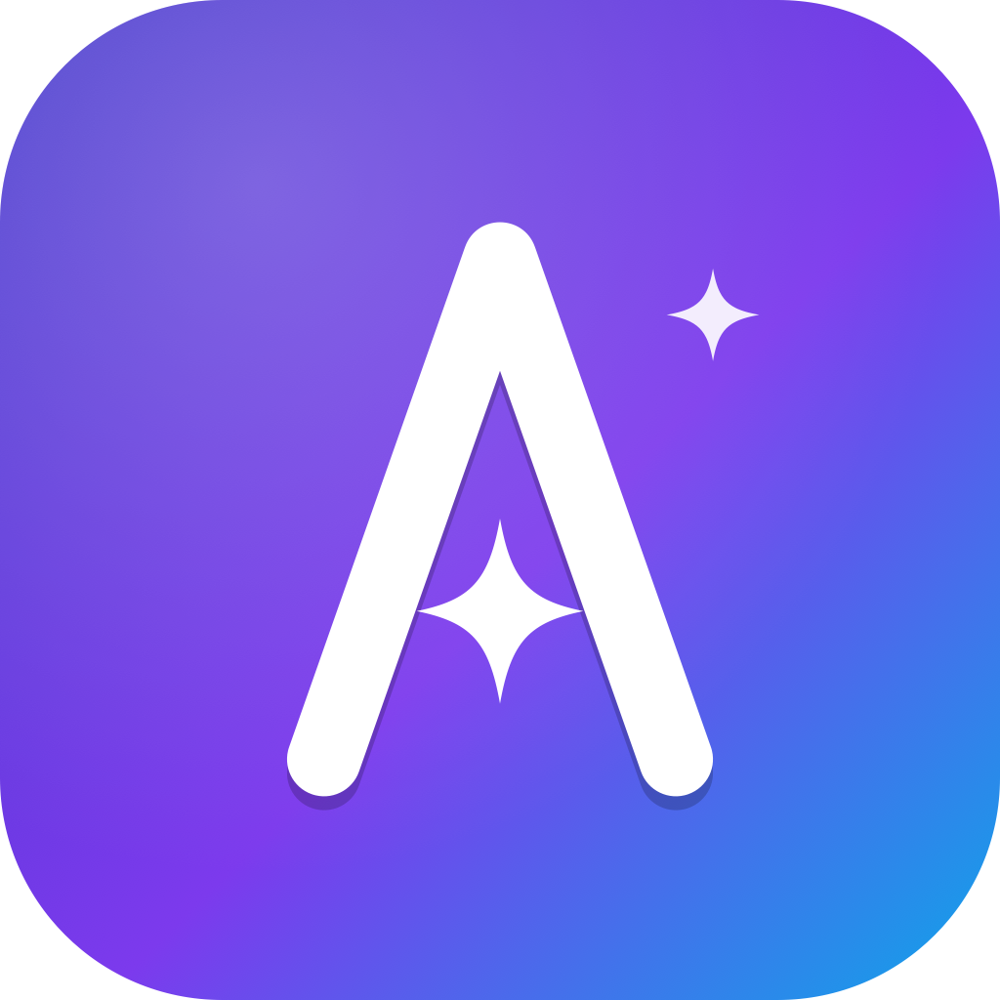
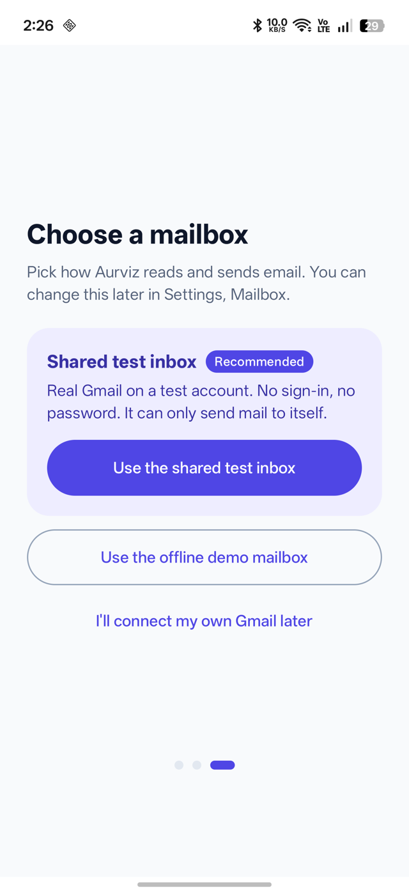
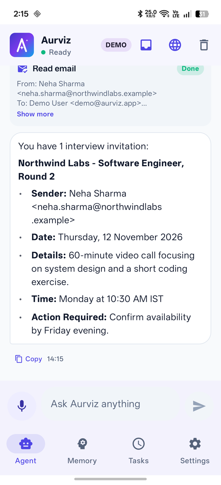
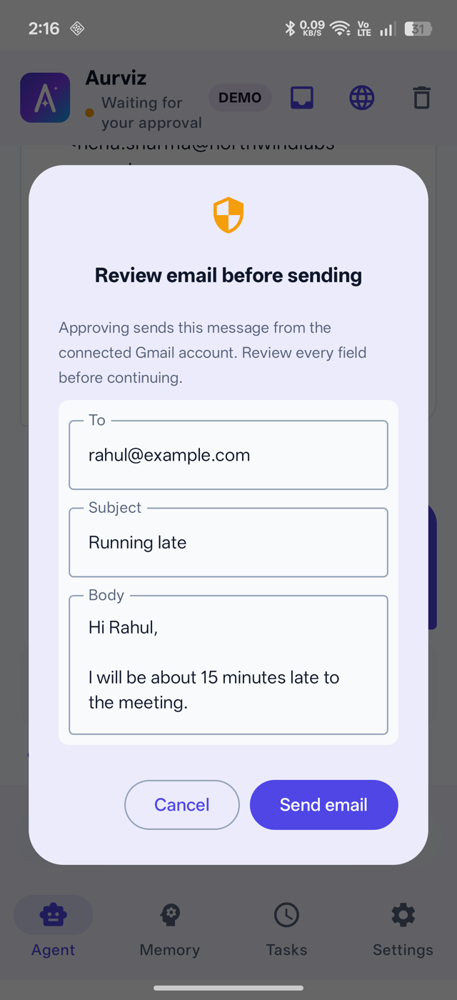
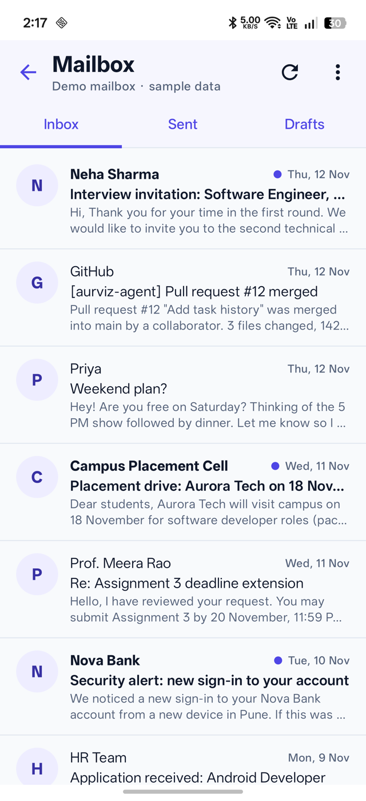
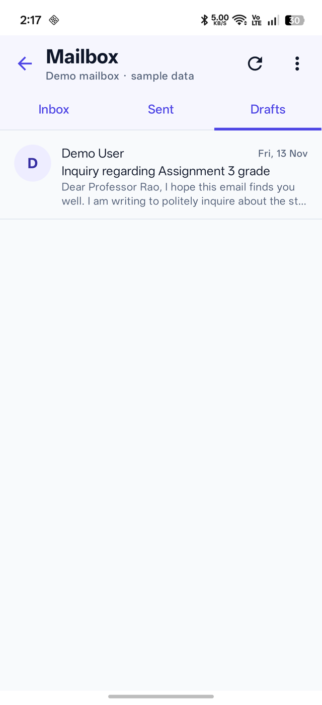
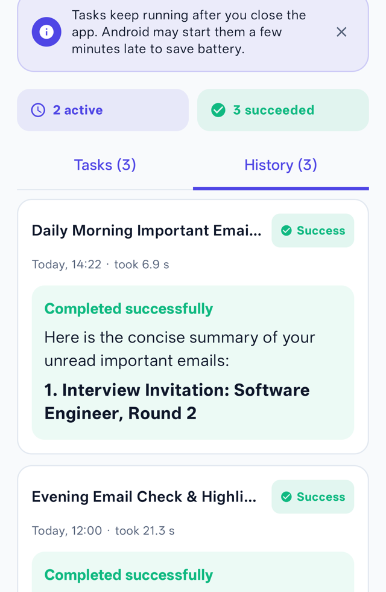
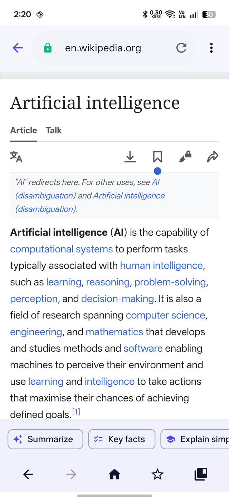
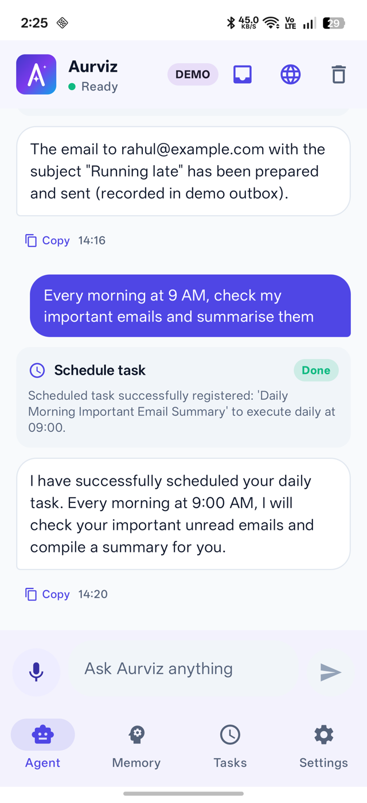
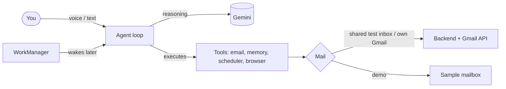

<p align="center">
  
</p>

<h1 align="center">Aurviz</h1>
<p align="center"><b>A personal AI agent for Android that understands, remembers, plans and acts.</b></p>

<p align="center">
  
  
  
  
</p>

Aurviz is more than a voice-enabled chatbot. It listens to spoken or typed instructions, remembers your preferences, plans multi-step work, **uses tools** (email, memory, scheduler, web browser) and **executes tasks**, including scheduled ones that run while the app is closed.

> **Evaluating this project?** You need no credentials. Install the APK and tap **Use the shared test inbox** (real Gmail on a throwaway account, one tap, no password), or choose the offline **demo mailbox**. Then follow the ten-minute script in the **[Evaluator Guide](docs/EVALUATOR_GUIDE.md)**.

## What it can do

| | |
|---|---|
| **Understand** | Voice and text commands. Gemini decides which tool to use and breaks complex requests into steps |
| **Email** | Search, read and summarize mail; save drafts; send only after you approve To, Subject and Body in an editable dialog. A built-in **mailbox viewer** shows Inbox, Sent and Drafts and updates live |
| **Three mailboxes** | **Shared test inbox** (real Gmail, no credentials, self-send only), **Demo mailbox** (offline sample data you can view and reset), or **your own Gmail** (Google sign-in) |
| **Remember** | Saves preferences ("I prefer formal emails") and applies them to later answers. View, edit and delete memories |
| **Schedule** | "Every morning at 9, summarize my inbox" runs in the background with retries, pause and resume, notifications and a full history |
| **Browse** | A controlled in-app browser with search, find in page, reader view, bookmarks, and AI actions that summarize or answer questions about the open page |
| **Stay safe** | OAuth (no passwords), encrypted tokens, approval before any send, background runs can never send |
| **Explain failures** | Plain-language errors with a next step and a Try again button |

## Screenshots

<table>
<tr>
<td align="center"><br><sub>Choose a mailbox</sub></td>
<td align="center"><br><sub>Search, read, summarize</sub></td>
<td align="center"><br><sub>Approval before sending</sub></td>
<td align="center"><br><sub>Mailbox viewer</sub></td>
</tr>
<tr>
<td align="center"><br><sub>Drafts update live</sub></td>
<td align="center"><br><sub>Readable task history</sub></td>
<td align="center"><br><sub>Browser with AI actions</sub></td>
<td align="center"><br><sub>Dark theme</sub></td>
</tr>
</table>

## How it works



Three concerns, kept separate: **Gemini reasons**, **Kotlin tools execute**, **WorkManager schedules**. Read the [Architecture](docs/ARCHITECTURE.md) for diagrams and design decisions.

## Quick start

```sh
git clone https://github.com/AdityaKushwaha404/Aurviz_agent.git
cd Aurviz_agent
echo "gemini.api.key=YOUR_GEMINI_KEY" >> local.properties   # optional, bundles a key into the APK
./gradlew app:assembleDebug
adb install -r app/build/outputs/apk/debug/app-debug.apk
```

Run the tests:
```sh
./gradlew app:testDebugUnitTest     # 86 Android tests
cd backend && npm ci && npm test    # 18 backend tests
```

## Documentation

| Document | Purpose |
|---|---|
| [Evaluator Guide](docs/EVALUATOR_GUIDE.md) | Test every feature in ten minutes without credentials |
| [Software Requirements Specification](docs/SRS.md) | Functional and non-functional requirements with acceptance criteria |
| [Architecture](docs/ARCHITECTURE.md) | Design, diagrams, security, decisions and trade-offs |
| [Test Report](docs/TEST_REPORT.md) | Automated and on-device results, requirement-to-evidence matrix |
| [Performance](docs/PERFORMANCE.md) | Latency measured on a physical device |
| [User Guide](docs/USER_GUIDE.md) | How to use every feature |
| [Backend API](docs/API.md) | REST endpoints and delivery semantics |
| [Build and Deployment](docs/DEPLOYMENT.md) | Building the APK, running the backend, Google Cloud setup |
| [Submission summary](SUBMISSION.md) | One-page status against the assignment |

A single printable PDF of these documents is generated by `python3 docs/build_report.py` (see [docs/Aurviz_Project_Report.pdf](docs/Aurviz_Project_Report.pdf)).

## Project structure

```
app/                     Android app (Kotlin, Compose, Room, WorkManager)
  presentation/          Screens and ViewModels
  domain/                Orchestrator, tool contract, mail abstraction, models (pure Kotlin)
  data/                  Gemini client, mail services, Room, tools
  service/               Background worker, voice, browser controller
backend/                 Node.js + PostgreSQL service (OAuth, Gmail API, job queue)
docs/                    Documentation and logo
```

## Known limitations

- WorkManager is durable but not exact to the minute; Android may delay tasks.
- `gmail.readonly` is a Google restricted scope: your own Gmail must be an OAuth test user until the app is verified. The shared test inbox and the demo mailbox avoid this for evaluation.
- Memory search matches words, not meaning.
- The controlled browser is not a hardened sandbox; avoid sign-in or payment pages.
- A Gemini key bundled into an APK can be extracted; production should proxy Gemini through the backend.

## Author
Aditya Kushwaha
