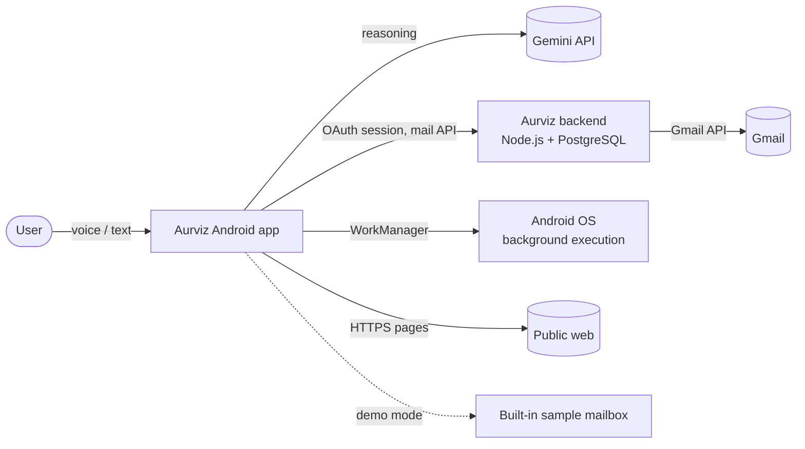
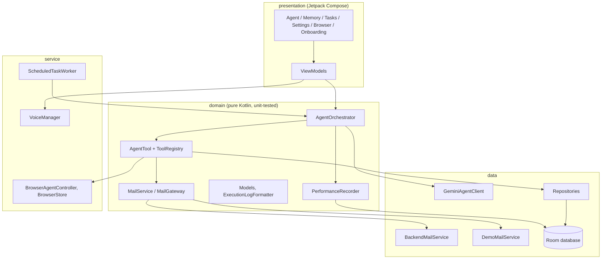
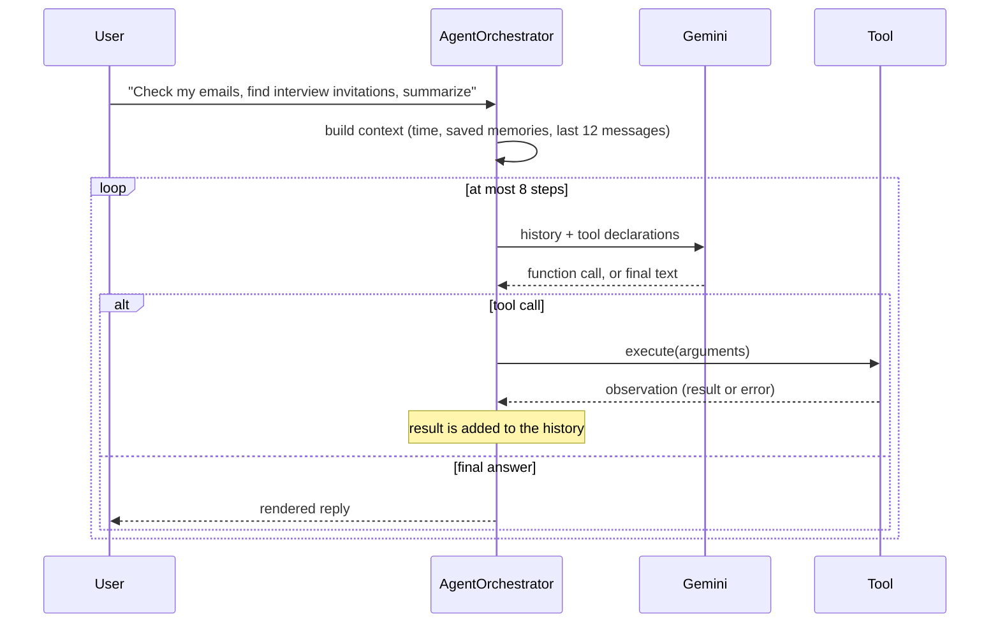
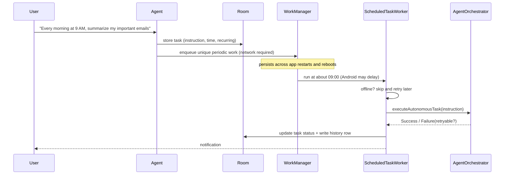
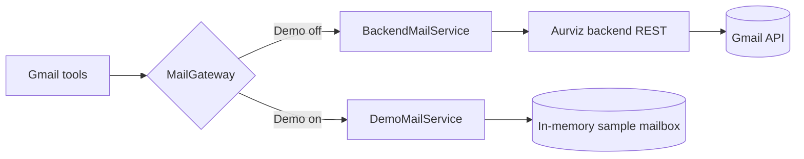
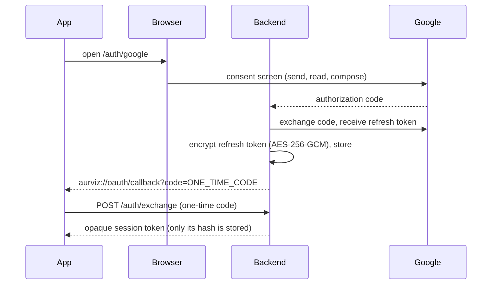

# Architecture

Aurviz is an Android app (Kotlin, Jetpack Compose) plus a small Node.js backend. This document explains how the pieces fit together, why they are separated the way they are, and how to extend the system.

## 1. System context

## 2. Three separate concerns

The most important design decision: **thinking, doing and timing are three different things owned by three different components.**

| Concern | Owner | Where in code |
|---|---|---|
| Reasoning: decide the next step | Gemini via function calling | `GeminiAgentClient`, prompt in `AgentOrchestrator` |
| Execution: perform the operation | Kotlin `AgentTool`s and the backend | `data/tools/*`, `backend/src/routes/*` |
| Scheduling: run later | Android WorkManager (persists its own state) | `TaskSchedulerRepositoryImpl`, `ScheduledTaskWorker` |

Gemini cannot wake an app. A scheduled task is stored in Room and registered with WorkManager. When WorkManager runs the worker, the worker calls the same agent loop in **background mode**, which has stricter safety rules (see section 6).

## 3. Layers of the Android app

Rules that keep it maintainable:
- `domain` never imports Android UI classes, so the orchestrator is covered by plain JVM tests with fake clients.
- Tools depend on interfaces (`MailService`, repositories), not on concrete networking classes.
- The UI observes `StateFlow`s and holds no business logic.

## 4. The agent loop

Behaviours worth knowing:
- **Planning rules** are in the system instruction: one tool at a time, search then read then summarize, draft versus send, ask when the recipient is ambiguous, never invent mail content.
- **Memory** (lexical match plus the most recent entries) is injected on every turn, so a saved preference like "formal emails" affects later drafts.
- **Step limit:** a request cannot loop forever. Reaching the limit shows an explicit message with a retry action.
- **Empty answers:** if the model returns no real text (for example a lone dash) the orchestrator asks once more, then falls back to a retryable error.
- **Attachments:** the browser and share-intent can pass page or text content to the model. It is sent only for the action the user triggered and is marked as untrusted data, which reduces prompt-injection risk.

## 5. Tools and the approval gate

| Tool | Side effect | Needs approval |
|---|---|---|
| `search_emails`, `read_email` | none | no |
| `create_email_draft` | saves a draft, sends nothing | no |
| `send_email` | sends mail | **yes** |
| `manage_memory` (save, recall, update, delete) | local data | no |
| `schedule_task` | registers a background job | no |
| `browse_web`, `open_url`, `read_page`, `scroll_page`, `extract_links`, `navigate_*` | none | no |
| `click_element`, `enter_text` | can change a web page | **yes** |

A tool marked `isSensitive` pauses the loop and shows an editable confirmation dialog. Only approval calls `executeConfirmed`. In background runs a sensitive tool is never executed at all; the model is told it was blocked and returns a draft or summary instead.

## 6. Scheduled tasks

Reliability rules:
- Unique work names (`task_<id>`, `task_<id>_manual`) stop duplicate enqueues; an in-process guard drops a concurrent second run.
- A run is **never reported as success** if a required tool failed. Transient failures (offline, rate limit, tool outage) are retried with exponential backoff up to 3 attempts and shown as "Retrying".
- Pause cancels the WorkManager job but keeps the task; resume re-registers it. A run that was already in flight never silently resumes a paused task.
- Every attempt is stored in `task_executions` and shown in Tasks, History. Raw errors are translated by `ExecutionLogFormatter` into a plain explanation with a next step.

## 7. Mail: real account or demo

`MailGateway` picks the implementation on every call, so the Demo switch takes effect instantly. The demo service understands the same Gmail-style operators (`subject:`, `from:`, `is:unread`, `newer_than:3d`, quoted phrases), keeps drafts and sent mail in their own folders, and makes `send` idempotent like the real backend. Nothing in demo mode contacts Gmail.

Real accounts use OAuth through the backend:

The app never sees a Google password or refresh token. Because the refresh token lives on the server, scheduled email summaries work while the phone is idle.

## 8. Web browser

`BrowserAgentController` is a single shared session between the agent's browser tools and the visible WebView. People get an address bar that searches when you type words, find in page, reader view, desktop site, text size, bookmarks, history and share. Four AI actions (Summarize, Key facts, Explain simply, Ask) read the page text and hand it to the agent.

Safety: HTTPS only; private, local and link-local addresses are rejected (DNS is resolved for agent opens); no JavaScript bridge to the app; file and content access disabled; Safe Browsing on; clicks and typing by the agent need approval and never submit forms. This is a controlled WebView, not a hardened sandbox.

## 9. Data

| Store | Technology | Content |
|---|---|---|
| `memories` | Room | key, content, category, timestamp |
| `scheduled_tasks` | Room | instruction, schedule, enabled, last status |
| `task_executions` | Room | per-run status, message, duration, attempt (500 rows kept) |
| `performance_samples` | Room | latency samples (1000 rows kept) |
| Chat | JSON file | last 100 messages |
| Secrets | EncryptedSharedPreferences | Gemini key, session token |
| Preferences | SharedPreferences | theme, demo mode, onboarding |
| Server | PostgreSQL + Prisma, pg-boss | accounts (encrypted token), sessions (hashed), scheduled emails, history, job queue |

Database upgrades use explicit migrations (`MIGRATION_1_2`), so memories and tasks are never wiped on update.

## 10. Security

| Threat | Mitigation |
|---|---|
| Stolen credentials | No passwords; OAuth with server-held refresh token (AES-256-GCM) |
| Token on device | Keystore-backed encrypted preferences, excluded from backup |
| Unwanted sending | Approval dialog for every send; background runs cannot send |
| Header injection in mail | Recipient and subject reject line breaks (app and server) |
| Replay or double send | Idempotency key per request; unique database constraint |
| Abuse of the API | Rate limiting, Helmet headers, 32 KB body limit, schema validation |
| Malicious web content | HTTPS only, private-address blocking, no JS bridge, content treated as untrusted data |
| Secrets in source | None committed; build-time Gemini key is read from the git-ignored `local.properties` |

Known limit: a Gemini key bundled into an APK can be extracted from the file. For production, route Gemini through the backend with quotas.

## 11. Extending Aurviz

Adding a capability, for example Google Calendar, needs **no change to the orchestrator**:
1. Implement `AgentTool` (and a backend route if it needs Google credentials).
2. Add its function declaration in `GeminiAgentClient`.
3. Register it in `AurvizApp`.
4. Set `isSensitive = true` if it has external side effects: it then automatically gets the approval gate and is blocked in background runs.

Swapping the mail provider means implementing `MailService` once; the tools and orchestrator are untouched, which is exactly how the demo mailbox was added.

## 12. Decisions and trade-offs

| Decision | Reason | Trade-off |
|---|---|---|
| Backend holds Google tokens | Scheduled mail works while the app is closed; no tokens on the phone | Needs a hosted service; free tier can sleep (the app warms it up and allows a long first request) |
| Gemini function calling | Reliable structured tool use | Depends on the model API; fallback chain mitigates model retirement |
| WorkManager for scheduling | Persistent, battery-aware | Not exact to the minute |
| Lexical memory search | Simple, fast, private | Not semantic; a vector index is a possible upgrade |
| Demo mailbox | Lets anyone evaluate without credentials | Sample data only |
