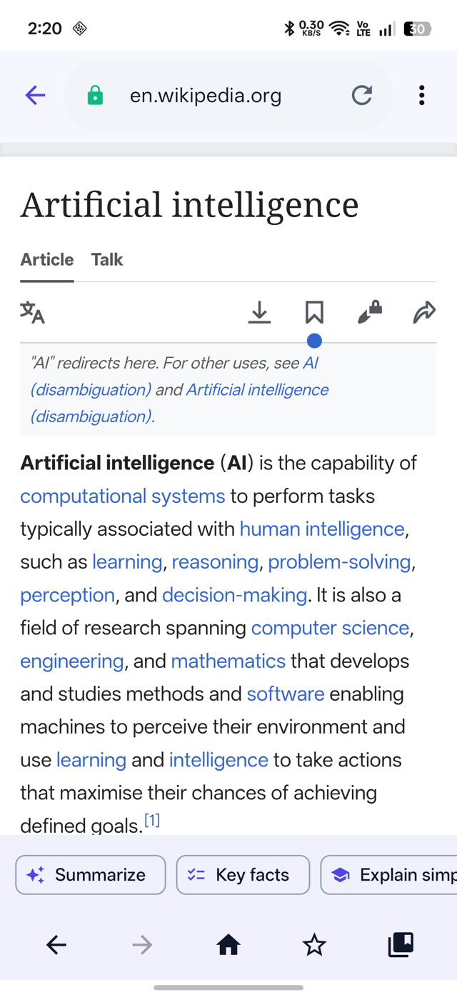
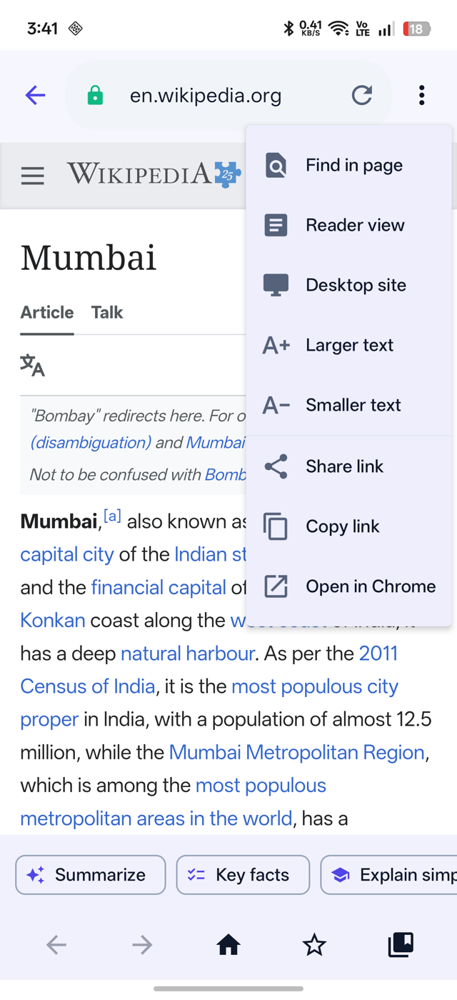
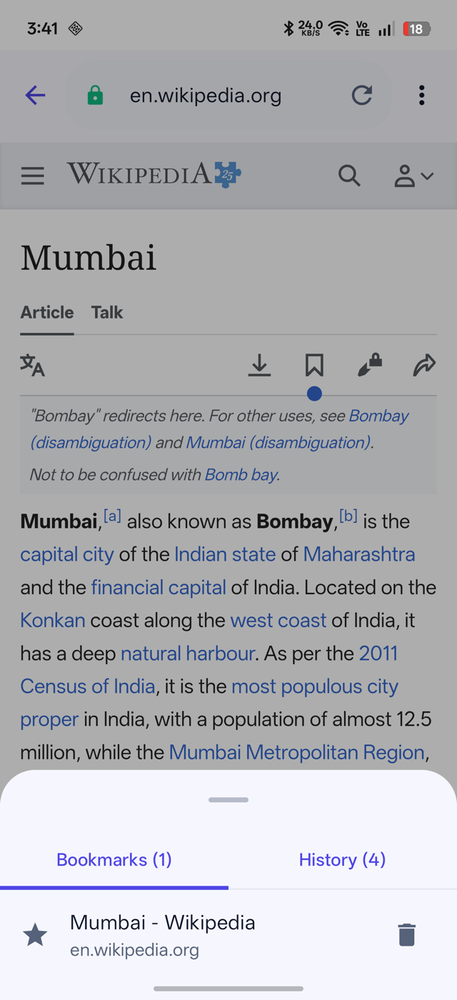
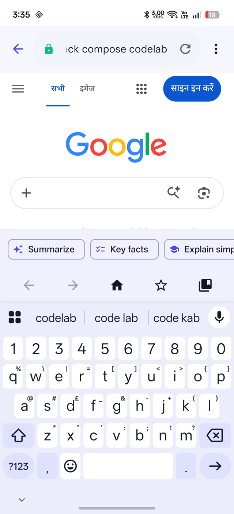
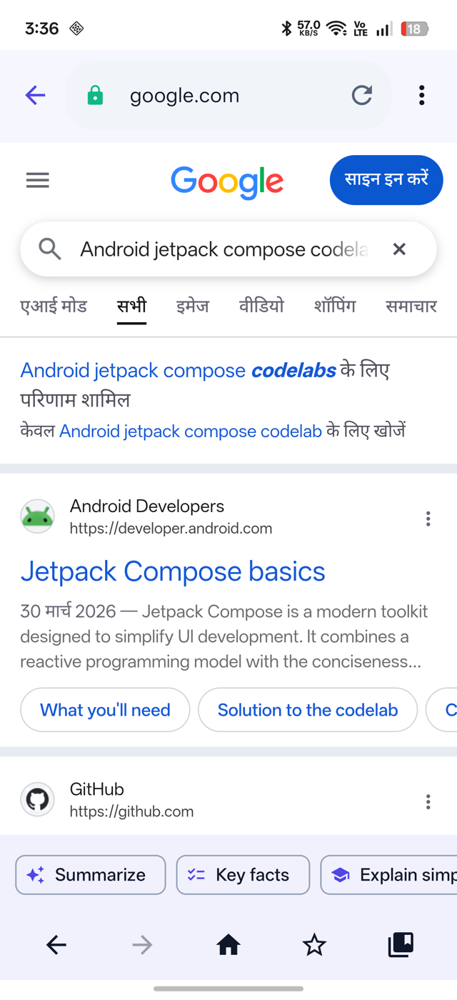
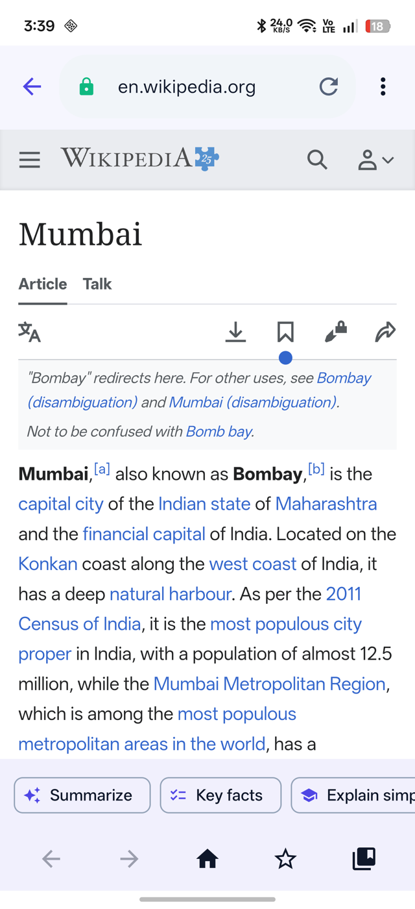
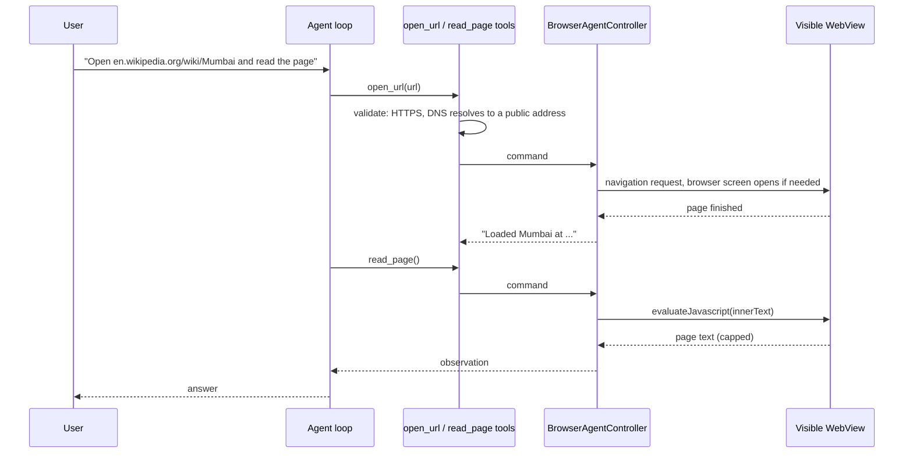
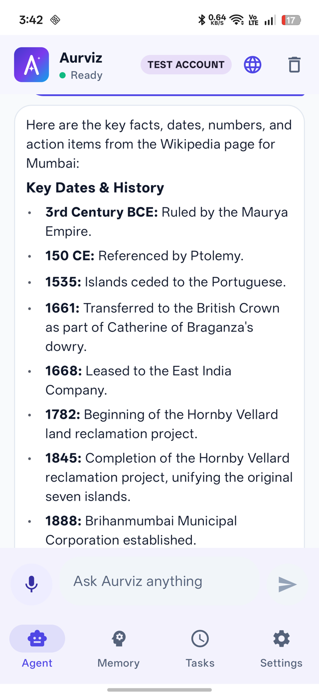
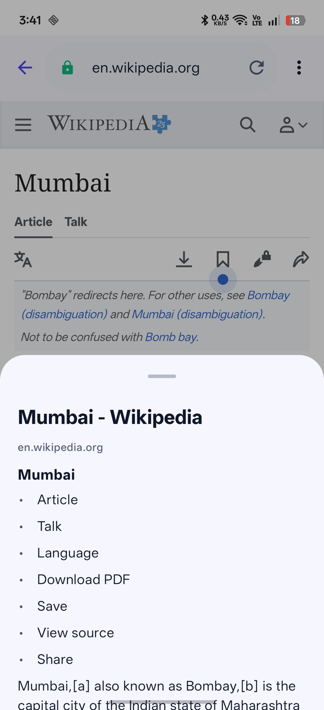

# The Aurviz Browser

Aurviz includes a controlled in-app browser. It serves two users at once: **people** get a real, comfortable browser, and the **AI agent** drives the same page through a small set of tools. Because both share one page, you can ask Aurviz to open a site, then keep reading and use the page's content with AI.

Open it with the globe icon in the chat header.

## 1. Features at a glance

| Area | What you get |
|---|---|
| Address bar | Type a website **or just words**: words become a web search |
| Page tools | Find in page, **Reader view**, Desktop site, Larger and Smaller text |
| Navigation | Back, forward, home, reload and stop, progress bar |
| Library | **Bookmarks** (star button) and **History**, stored on the phone |
| Sharing | Share link, Copy link, Open in Chrome |
| **AI on the page** | **Summarize**, **Key facts**, **Explain simply**, **Ask about this page** |
| Agent tools | `open_url`, `search_webpage`, `read_page`, `extract_links`, `scroll_page`, `navigate_back/forward`, `get_browser_state`, and approved `click_element` and `enter_text` |
| Safety | HTTPS only, private and local addresses blocked, no JavaScript bridge, approval for anything that changes a page |

<table>
<tr>
<td align="center"> Address bar, secure lock, AI action chips, bottom toolbar</td>
<td align="center"> Page tools menu</td>
<td align="center"> Bookmarks and History sheet</td>
</tr>
</table>

## 2. Search from the address bar

The address bar understands what you type. `news.ycombinator.com` becomes `https://news.ycombinator.com`; `http://` is upgraded to `https://`; plain words such as `android jetpack compose codelab` become a web search. This logic is a pure function (`BrowserUrl.resolve`) covered by unit tests.

<table>
<tr>
<td align="center"> Typing words, not a URL</td>
<td align="center"> The search runs and results load</td>
</tr>
</table>

## 3. Agent-driven browsing

Ask in chat: *"Open en.wikipedia.org/wiki/Mumbai and read the page."* The agent calls `open_url`, the browser screen opens by itself, the page loads, and `read_page` returns the text to the model. The page stays on screen for you to keep using.

<table>
<tr>
<td align="center"> Opened by the agent, ready for you to scroll, bookmark or ask about</td>
</tr>
</table>

## 4. AI on whatever page you are viewing

Four chips sit above the toolbar. Each one reads the current page text, sends it with a fixed instruction, and returns you to the chat with the answer:

- **Summarize**: a short bullet summary.
- **Key facts**: dates, numbers and action items.
- **Explain simply**: the page in beginner-friendly words.
- **Ask about this page**: type your own question, for example "What is the deadline mentioned here?"

<table>
<tr>
<td align="center"> "Key facts" on the Mumbai article: dated, structured, formatted</td>
</tr>
</table>

Privacy: page text is sent to the model **only when you tap one of these actions**, it is capped in size, and it is marked as untrusted data so instructions hidden inside a web page are not obeyed (prompt-injection defence).

## 5. Reader view, bookmarks and history

**Reader view** extracts the article text (headings, paragraphs and long list items) into a clean sheet, skipping menus, info boxes and references, with a **Summarize with Aurviz** button.

<table>
<tr>
<td align="center"> Reader view sheet</td>
<td align="center"> A bookmarked page; the History tab lists visited pages</td>
</tr>
</table>

Bookmarks and history are stored locally (history keeps the last 60 pages and can be cleared). Nothing is uploaded.

## 6. Safety model

| Risk | Control |
|---|---|
| Opening dangerous or internal addresses | HTTPS only; `localhost`, private, link-local and unique-local ranges rejected; the agent's `open_url` also resolves DNS before loading |
| Page scripts talking to the app | No `addJavascriptInterface`; file and content access disabled; mixed content blocked; Safe Browsing on |
| The agent changing a page | `click_element` and `enter_text` pause for an approval dialog showing the page, the selector and the text; typing never submits a form |
| Hidden instructions in page text | Page content passed to the model is labelled untrusted and is only sent on user action |
| Background misuse | Screen-bound tools are refused in scheduled runs, so a background task can never pop a browser open |

This is a **controlled WebView, not a hardened sandbox**. Avoid signing in or paying on pages opened here.

## 7. Verification status

Verified on a physical phone: address-bar search, page menu, agent-opened pages, reader view, bookmarks and history, and all AI actions. Present in the menu but not individually exercised on the device: find-in-page match counter, desktop-site toggle, text size and share. See the [Test Report](TEST_REPORT.md).

## 8. Requirements covered

FR-09 (web automation), FR-21 (browser tools for people), FR-22 (AI on web pages), NFR-02 and NFR-11 (security and privacy). Tests: `BrowserUrlTest`, `ControlledWebScraperTest`, and `AgentReliabilityTest.backgroundRunNeverUsesScreenBoundTools`.
