# Email Flow: How Aurviz Reads and Sends Real Gmail

This document shows, end to end and with evidence, how Aurviz works with a **real Gmail account**. The reviewer test account is `adityatesting404@gmail.com`, a throwaway account created only for evaluation. Every Aurviz screenshot below was taken on a physical phone, and every Gmail screenshot was taken in the Gmail app of the same account, so the result of each action can be checked independently.

## 1. The idea in one picture

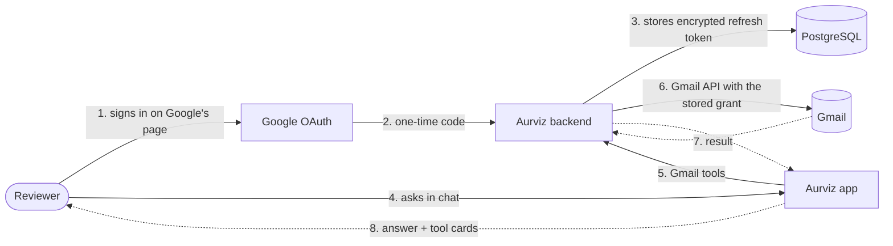

Key points:

- **No password ever touches Aurviz.** The reviewer types the email and password only on Google's own sign-in page.
- **The phone never holds a Google token.** The backend keeps an AES-256-GCM encrypted refresh token; the phone only holds an opaque session token.
- **Sending is always approved by a person**, and background tasks can never send.

## 2. Signing in (about one minute)

Open **Settings, Mailbox, Test Gmail account**. The email and password are shown with copy buttons, followed by six numbered steps.

<table>
<tr>
<td align="center">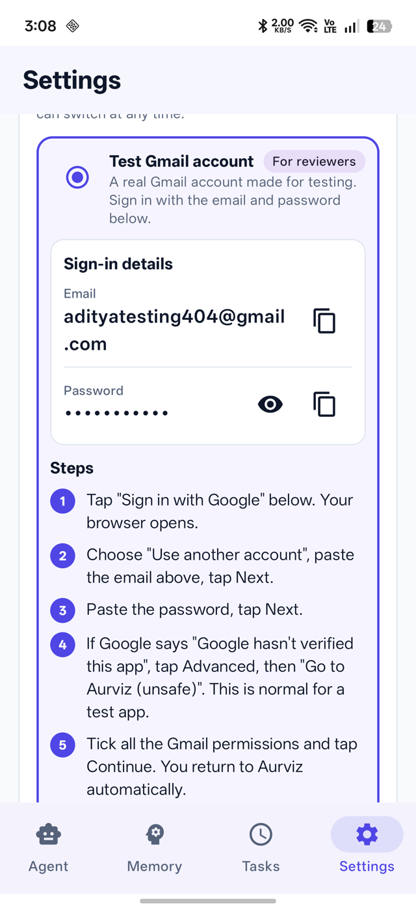 Email, hidden password with show and copy buttons</td>
<td align="center">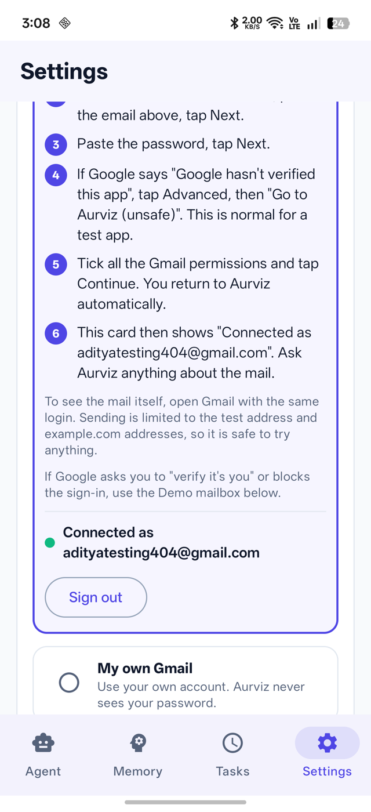 Six numbered steps and the status line</td>
</tr>
</table>

1. Tap **Sign in with Google**. The browser opens Google's sign-in.
2. Choose **Use another account**, paste the email, **Next**.
3. Paste the password, **Next**.
4. Google shows **"Google hasn't verified this app"**. This is expected for a test application. Tap **Continue** (or Advanced, then Go to Aurviz).
5. Tick the Gmail permissions and tap **Continue**. You return to Aurviz automatically.
6. The card now reads **Connected as adityatesting404@gmail.com**.

### What happens behind the scenes

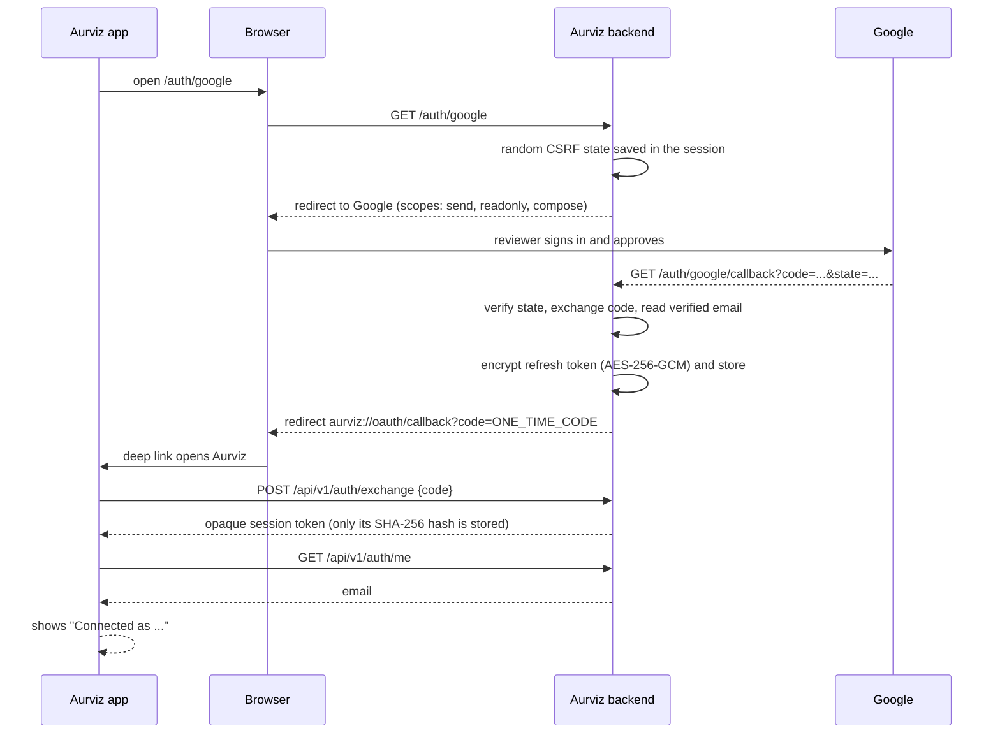

Security properties that are visible in this flow: CSRF `state` check, single-use one-time code (5 minutes), hashed session tokens, encrypted refresh tokens, and no Google credentials in the APK.

## 3. Reading the real inbox

Ask: *"Search my inbox and tell me how many emails there are and who they are from."* Aurviz calls the `search_emails` tool, which goes to the backend and then to Gmail. The tool card shows what ran; the answer is built only from the returned messages.

<table>
<tr>
<td align="center">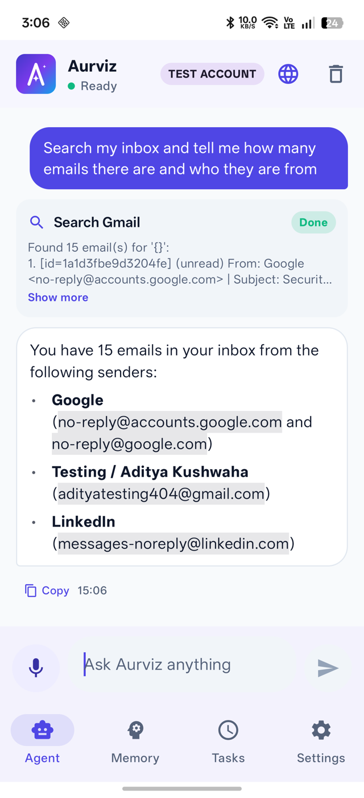 Aurviz: search_emails on the real inbox, then a summary</td>
</tr>
</table>

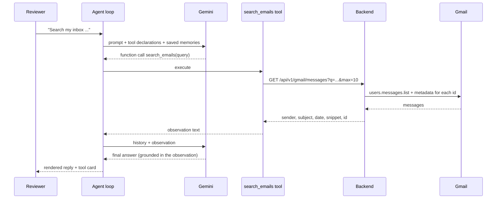

The model is told never to invent mail content. If a search returns nothing, the tool says so plainly.

## 4. Sending an email (with approval)

Ask: *"Send an email to adityatesting404@gmail.com with subject Welcome to Aurviz and body Hello! This email was written and sent by the Aurviz AI agent after I approved it."*

Aurviz does **not** send yet. It pauses the agent loop and shows an editable **approval dialog** (To, Subject, Body). Only the **Send email** button releases the send. Cancel sends nothing.

<table>
<tr>
<td align="center">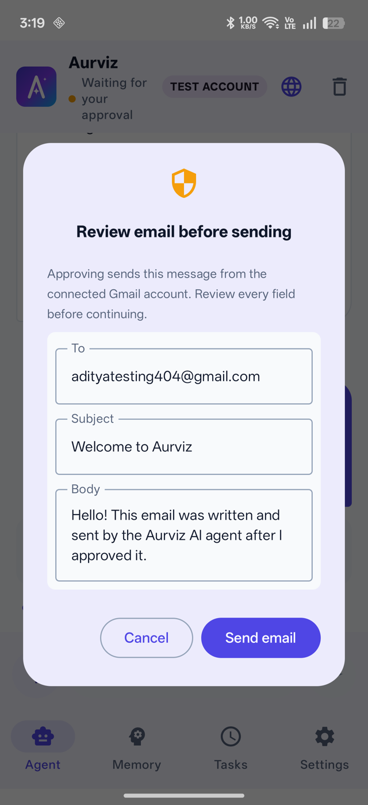 1. Approval dialog, fields are editable</td>
<td align="center">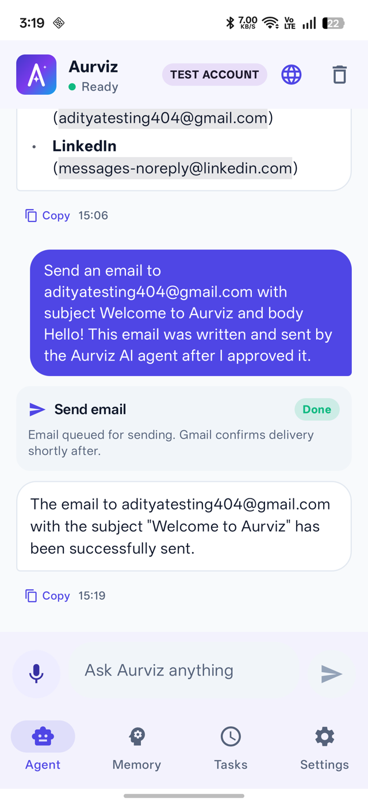 2. After approval: tool card "Email queued for sending"</td>
<td align="center">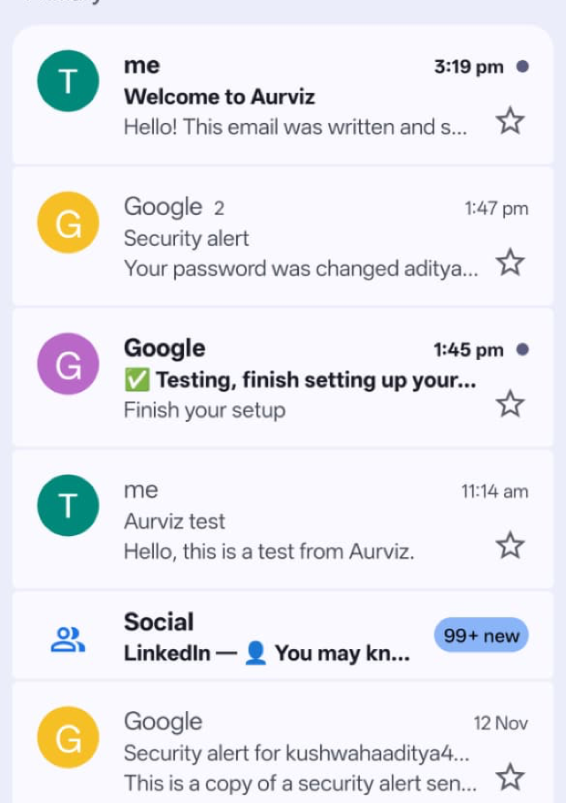 3. Gmail: "Welcome to Aurviz" has arrived</td>
<td align="center">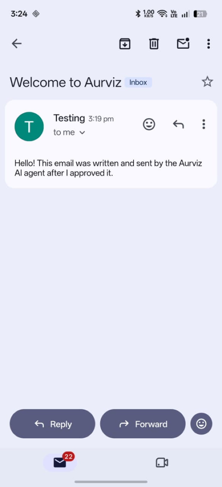 4. Gmail: the email opened, with the body the agent wrote</td>
</tr>
</table>

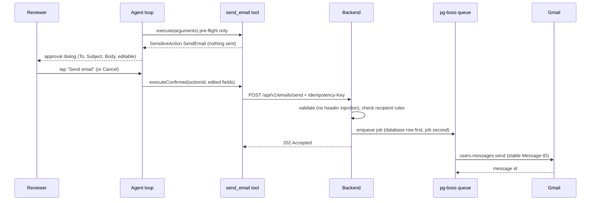

What makes the send safe and reliable:

- **Approval is enforced in code**, not by the prompt. A tool marked sensitive cannot run without `executeConfirmed`.
- **Idempotency key**: tapping twice or retrying never sends two copies (a unique database constraint).
- **Header-injection protection**: line breaks in recipient or subject are rejected in the app and again on the server.
- **Honest delivery wording**: the card says "queued"; Gmail confirms delivery moments later, as the inbox screenshot shows. Ambiguous network outcomes are stored as `UNKNOWN` and never resent automatically.
- **Test-account guardrails (server side)**: the shared account can send only to itself or to `example.com`, `.org`, `.net`, `*.example` and `*.test` addresses (which reach no real person), and it cannot be disconnected.

## 5. Drafts: "prepare it, but don't send it"

Ask: *"Draft a formal email to meera.rao@university.example asking about my Assignment 3 grade. Do not send it."* The agent chooses `create_email_draft` instead of `send_email`, applies the saved preference for formal tone, and saves the draft in Gmail. There is no approval dialog because nothing leaves the account.

<table>
<tr>
<td align="center">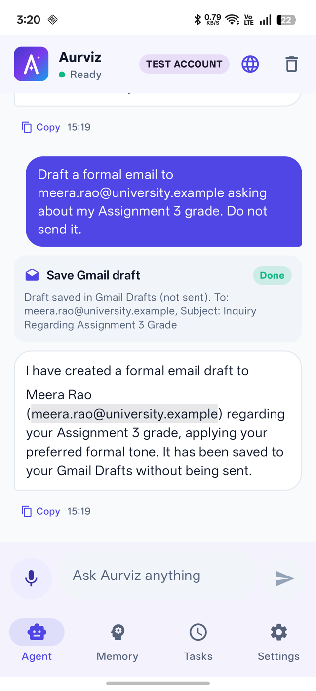 Aurviz: "Draft saved in Gmail Drafts (not sent)"</td>
<td align="center">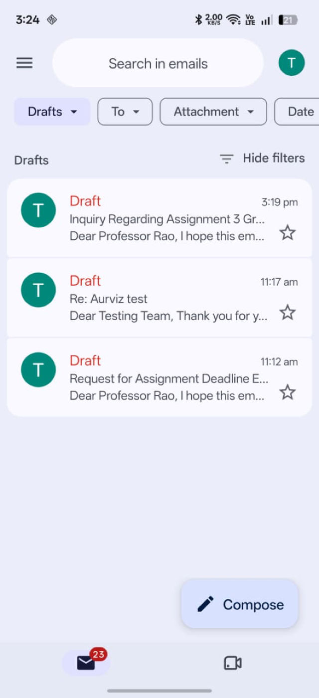 Gmail: the Drafts folder shows the new draft at the top</td>
<td align="center">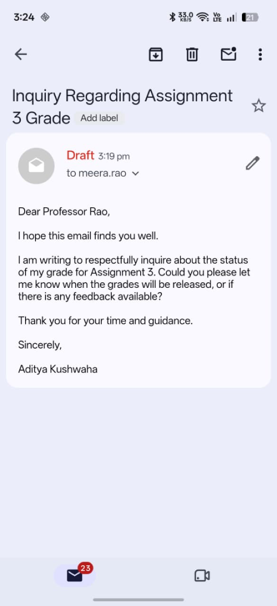 Gmail: the draft opened, formal wording, signed with the user's name</td>
</tr>
</table>

The two older drafts visible in the Drafts folder came from earlier test runs of the same feature (a deadline-extension request and a reply to the first test email). They show the same behaviour on different prompts.

## 6. How the pieces map to requirements

| Step | Requirement |
|---|---|
| OAuth sign-in, no password in the app | FR-18, NFR-02 |
| Search and read mail with Gmail operators | FR-15, FR-04 |
| Multi-step: search, read, summarize | FR-12 |
| Approval before sending | FR-08 |
| Drafts that are never sent | FR-16 |
| Tool cards and plain errors | FR-14, FR-20 |
| Restricted shared account | FR-26, NFR-12 |

## 7. No account? Use the demo mailbox

If Google asks to verify the sign-in (a shared account used from many phones can trigger this), choose **Settings, Mailbox, Demo mailbox**. It offers the same search, read, draft and send features on ten sample emails stored on the phone, and the in-app viewer shows Inbox, Sent and Drafts updating live. See the [Evaluator Guide](EVALUATOR_GUIDE.md#3-see-the-demo-mailbox).
