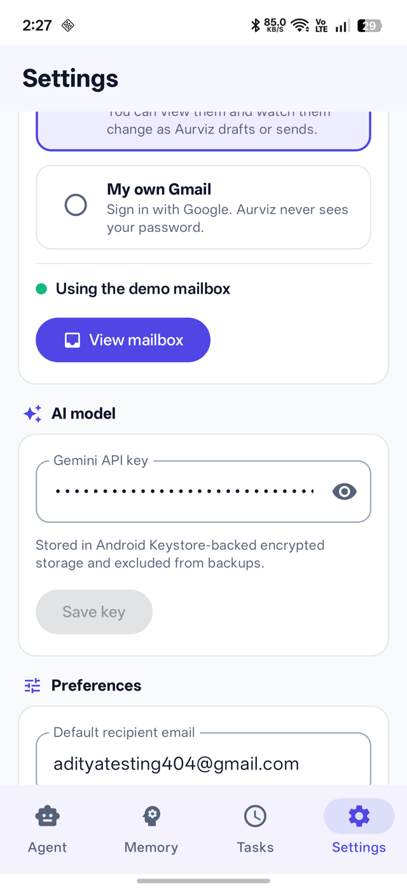

# Evaluator Guide

Test every feature of Aurviz in about ten minutes. **You do not need a password, a Google account or any setup.** Aurviz offers three mailboxes; the recommended one needs a single tap.

## 1. Install and first launch

1. Install the APK on an Android 8.0 or newer phone (allow "install unknown apps" for your file manager or browser).
2. Open **Aurviz**. You see the animated logo, then a short walkthrough.
3. On the last page, tap **Use the shared test inbox** (recommended). That is the only step.
4. Allow the microphone and notification permissions when asked.

<table>
<tr>
<td align="center"> Animated splash</td>
<td align="center"> Welcome</td>
<td align="center"> What it can do</td>
<td align="center"> Choose a mailbox</td>
</tr>
</table>

The AI key is built into the APK. If your build has none, open **Settings, AI model** and paste a free Gemini key from <https://aistudio.google.com/>.

## 2. The three mailboxes

| Mailbox | What it is | Credentials needed | Best for |
|---|---|---|---|
| **Shared test inbox** (default) | Real Gmail on a dedicated test account (`adityatesting404@gmail.com`). The server holds the Google grant; your phone gets a short-lived session | None. One tap | Seeing the real Gmail integration |
| **Demo mailbox** | Ten sample emails stored on the phone. Fully offline | None | Trying everything with zero risk, including sending |
| **My own Gmail** | Your own account through Google's sign-in page | Your own Google account (must be an OAuth test user, see section 6) | Using your real mail |

Switch at any time in **Settings, Mailbox**. The header badge shows which one is active (**TEST INBOX** or **DEMO**).

<table>
<tr>
<td align="center"> Settings: Appearance and Mailbox</td>
<td align="center"> Mailbox status and View mailbox</td>
</tr>
</table>

### Why the shared test inbox is safe
Anyone with the APK can use it, so it is locked down on the server: it **can only send mail to itself**, it **cannot be disconnected or revoked** from the app, its sessions are short-lived and rate limited, and it is a throwaway account with no private data. You can try any request without affecting anyone.

### If the shared inbox is unavailable
If the server is waking up or updating, the app says so and offers the **demo mailbox**, which works offline. Nothing else changes.

## 3. See what is in the mailbox

Tap the **inbox icon** in the chat header (or **Settings, View mailbox**). The viewer shows **Inbox, Sent and Drafts**, with unread messages in bold. Tap a message to read it, then **Summarize with Aurviz**. In demo mode the viewer **updates live** as Aurviz drafts or sends, and the menu has **Reset demo mailbox**.

<table>
<tr>
<td align="center"> Inbox</td>
<td align="center"> Open a message</td>
<td align="center"> Drafts update live</td>
<td align="center"> Sent updates live</td>
</tr>
</table>

## 4. Ten-minute test script

Type each prompt, or tap the microphone and say it.

| # | Say or type | What you should see | Requirement |
|---|---|---|---|
| 1 | "Check my emails, find interview invitations and summarize them" | Cards "Search Gmail" then "Read email", then a structured summary (in demo: the Northwind Labs interview) | FR-03, 04, 12, 15 |
| 2 | "Which of my emails are important and unread?" | The important, unread messages | FR-15 |
| 3 | "Remember that I prefer formal emails" | A memory card; the Memory tab lists it | FR-05 |
| 4 | "Draft an email to meera.rao@university.example asking about my grade, but don't send it" | A formal draft is saved; nothing is sent. Open the **Drafts** tab to see it | FR-06, 16 |
| 5 | "Send an email to rahul@example.com saying I will be late" | An **approval dialog** with editable To, Subject and Body. Cancel sends nothing. Approve and it appears in **Sent** (the shared test inbox only accepts its own address; the demo mailbox accepts any) | FR-08 |
| 6 | "Every morning at 9 AM, check my important emails and summarize them" | Task created. Open **Tasks**, tap **Run now**; **History** shows the run | FR-10, 11, 13 |
| 7 | "Forget my email tone preference" | Memory deleted | FR-07 |
| 8 | "Open news.ycombinator.com and tell me the top 3 stories" | The in-app browser opens and the stories are listed | FR-09 |
| 9 | In the browser open a Wikipedia article and tap **Summarize** | Back in chat with a summary of that page | FR-22 |

<table>
<tr>
<td align="center"> Start screen</td>
<td align="center"> Search, read, summarize</td>
<td align="center"> Approval before sending</td>
<td align="center"> Scheduling by voice or text</td>
</tr>
</table>

## 5. More to explore

- **Tasks:** pause and resume a daily task. **History** shows each run with its duration, and failures are explained in plain words with a next step.
- **Browser (globe icon):** address bar that also searches, find in page, reader view, desktop site, text size, bookmarks, history, share. The AI buttons Summarize, Key facts, Explain simply and Ask about this page use the page you are viewing.
- **Settings, Appearance:** System, Light or Dark.
- **Settings, Performance:** latency measured on your device (median and p95).
- **Long-press the app icon:** shortcuts for Voice command, Summarize inbox and Tasks.
- **Share text** from any app to Aurviz to get a summary.
- **Failure handling:** switch on airplane mode and send a prompt. You get a clear message and a **Try again** button.

<table>
<tr>
<td align="center"> Tasks</td>
<td align="center"> Readable history</td>
<td align="center"> Browser with AI actions</td>
<td align="center"> Dark theme</td>
</tr>
</table>

## 6. Using your own Gmail (optional)

Google allows only listed accounts to grant the Gmail read permission while an app is in testing mode. The project owner can either:

1. **Add your account as a test user**: Google Cloud Console, APIs and Services, OAuth consent screen, Audience, Test users. Then choose **My own Gmail** in Settings and sign in on Google's own page. You never share a password with Aurviz or anyone.
2. **Publish the consent screen "In production"** (unverified). Any Google user can then continue through the "Google hasn't verified this app" warning, limited to 100 users until Google verifies the app.

## 7. Mapping to common evaluation criteria

| Criterion | Where to look |
|---|---|
| AI reasoning and tool calling | Scripts 1, 4, 5; the tool cards in chat; [Architecture, the agent loop](ARCHITECTURE.md#4-the-agent-loop) |
| Modular architecture | [Architecture](ARCHITECTURE.md); the `domain`, `data`, `presentation`, `service` packages |
| Persistent memory | Scripts 3, 4, 7; restart the app and open the Memory tab |
| Background scheduling | Script 6; [Architecture, scheduled tasks](ARCHITECTURE.md#6-scheduled-tasks) |
| OAuth and secure email | Section 2 and 6; [Security](ARCHITECTURE.md#10-security) |
| Error handling and reliability | Airplane-mode test; Tasks, History; [Test Report](TEST_REPORT.md) |
| Performance measurement | Settings, Performance; [Performance](PERFORMANCE.md) |
| UI and UX | The whole app: dark mode, onboarding, animations, mailbox viewer |
